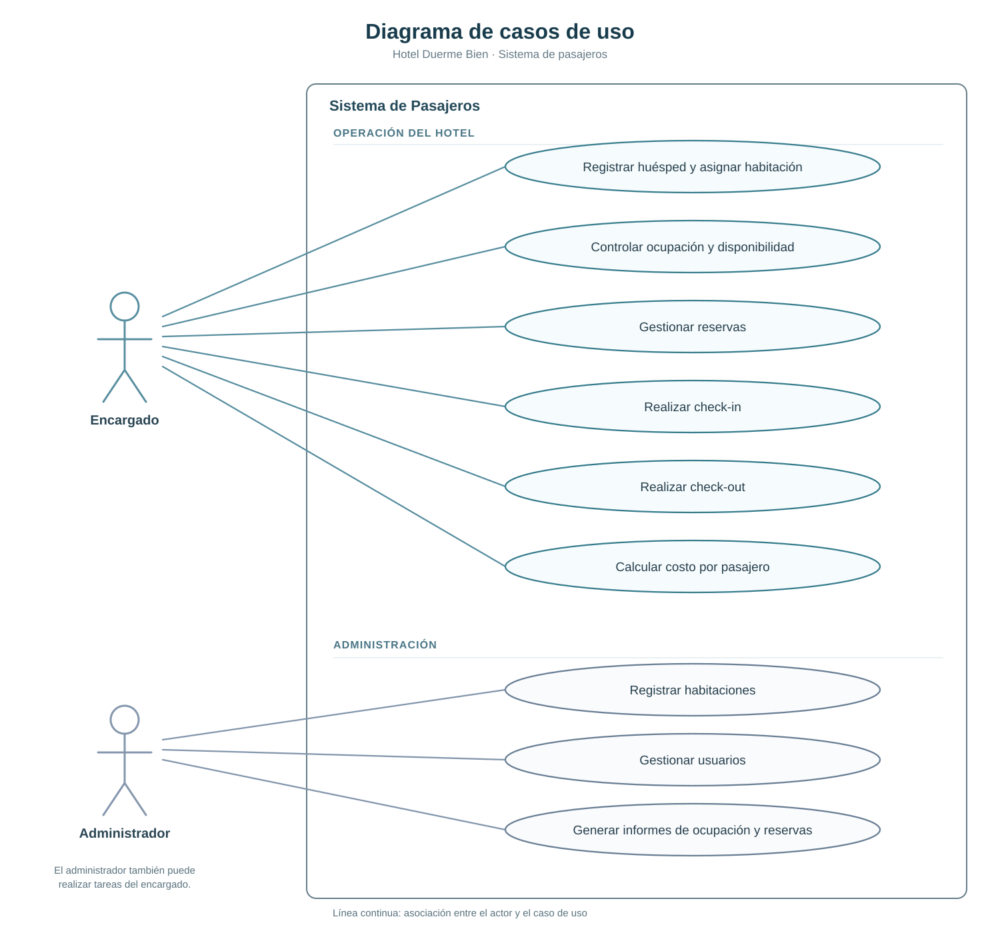
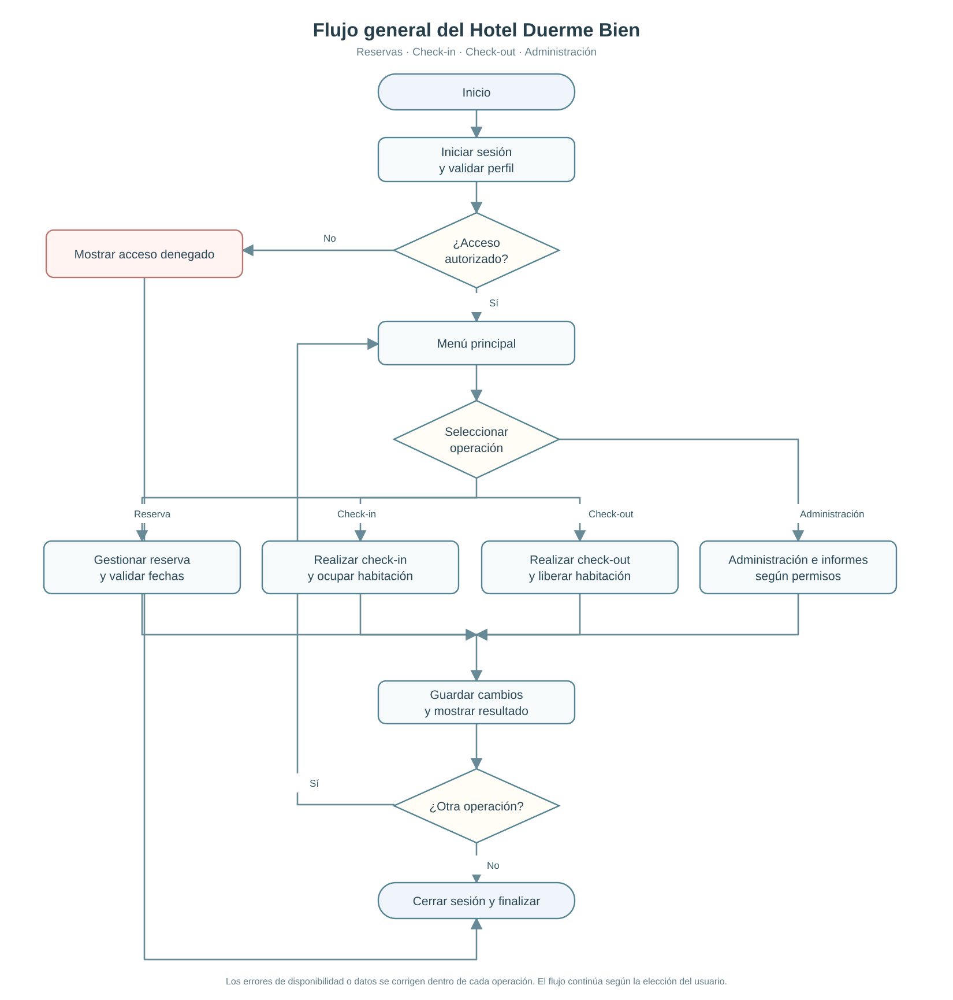
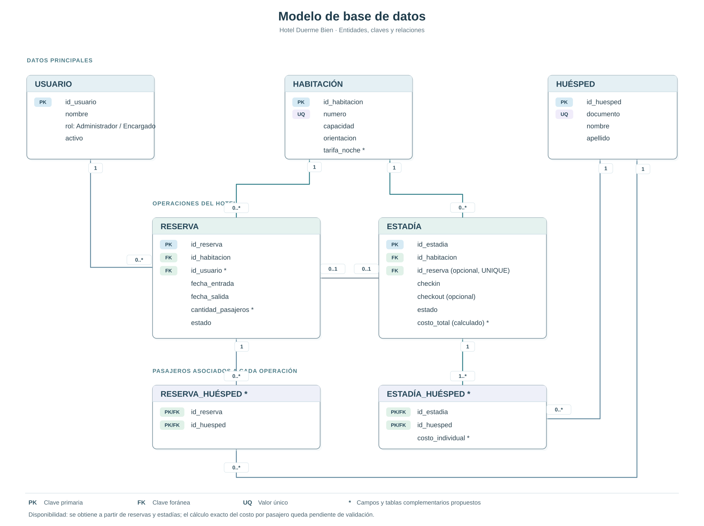
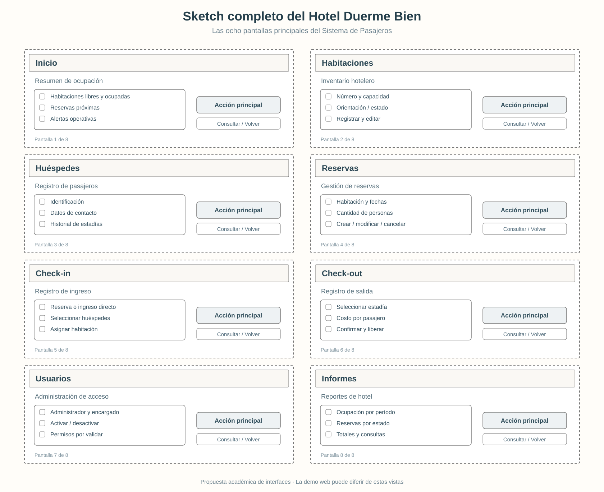
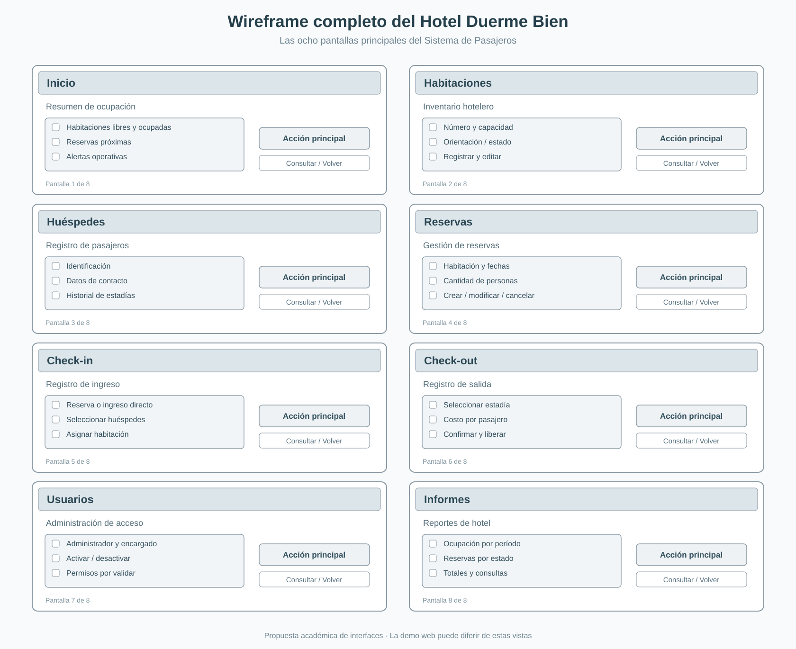
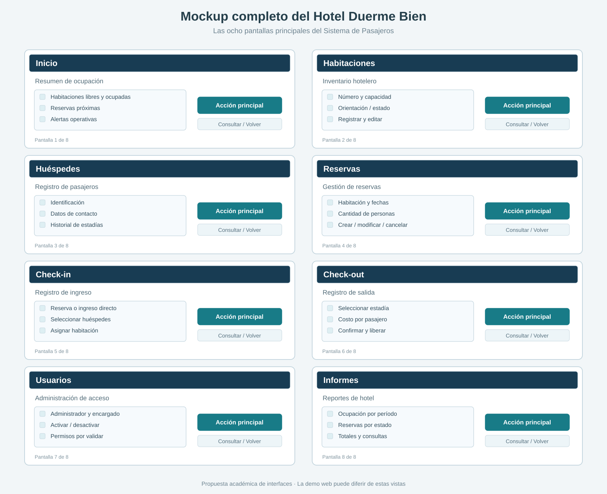
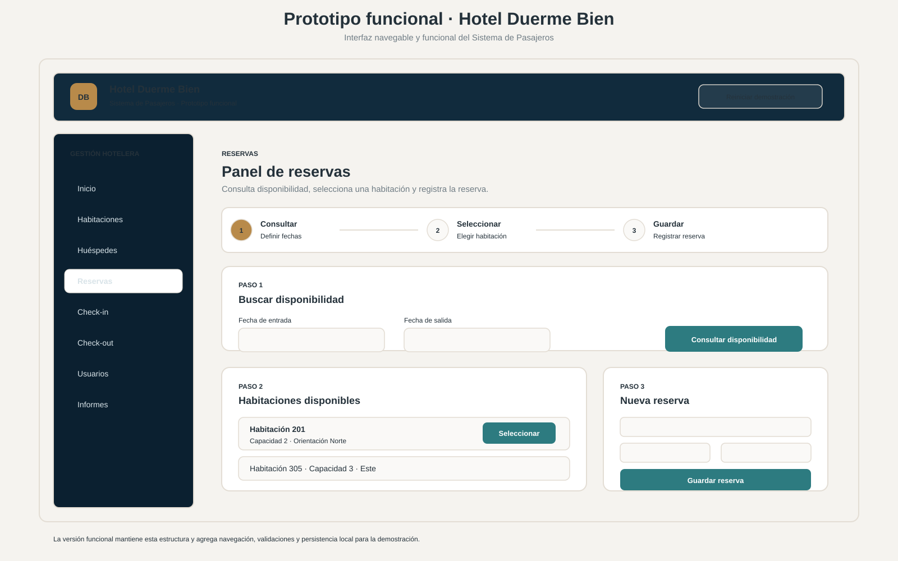

# Hotel Duerme Bien

**Sistema de Pasajeros · Caso 6**

Proyecto de análisis, modelado y prototipo para gestionar habitaciones, huéspedes, reservas, ocupación, check-in, check-out, usuarios e informes.

## 1. Informe de requerimientos

[Ver informe completo](entrega-final/01-requerimientos.md)

## 2. Diagrama de casos de uso completo

  

## 3. Diagrama de flujo completo

  

## 4. Modelo de base de datos completo

  

## 5. Sketch completo

  

## 6. Wireframe completo

  

## 7. Mockup completo

  

## 8. Prototipo funcional

  

*Haz clic en la imagen para abrir el prototipo interactivo.*

## 9. Kanban

[Ver planificación del proyecto](entrega-final/09-kanban.md)

## 10. Demo

[Abrir demo en Figma](https://www.figma.com/proto/7kS6Wuh6nwt2lcl4bB1w50/Hotel-Duerme-Bien?node-id=6-180&starting-point-node-id=6%3A180&scaling=contain)

## 11. Informe y defensa

[Ver material de exposición](docs/16_DOCUMENTO_MAESTRO_PARA_EXPLICAR.md)

---

*Las imágenes son una propuesta académica. La tarifa definitiva y los permisos exactos requieren validación. Las fuentes anteriores y los archivos editables permanecen en el repositorio.*
