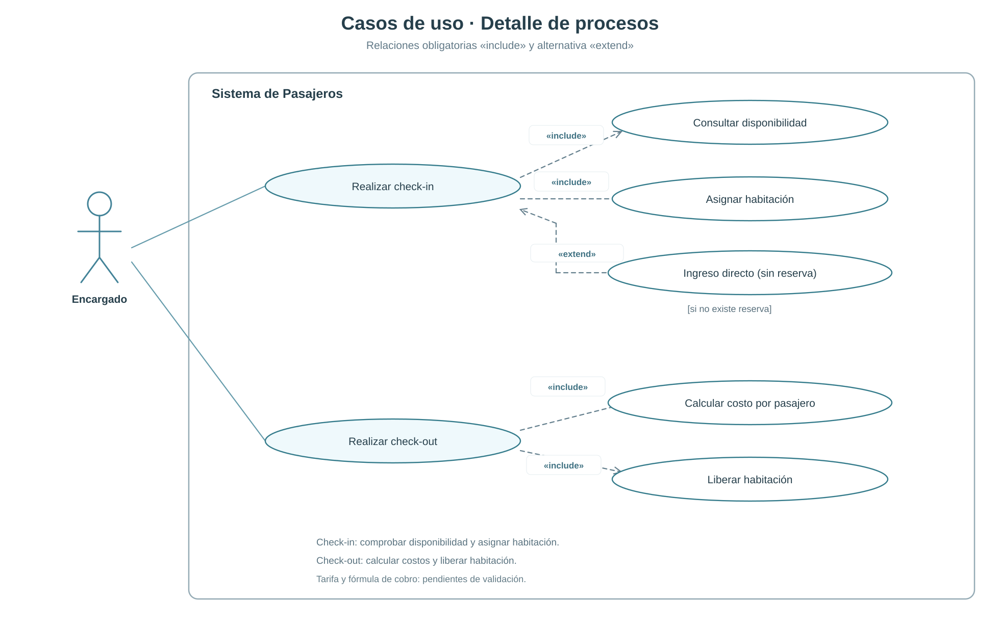
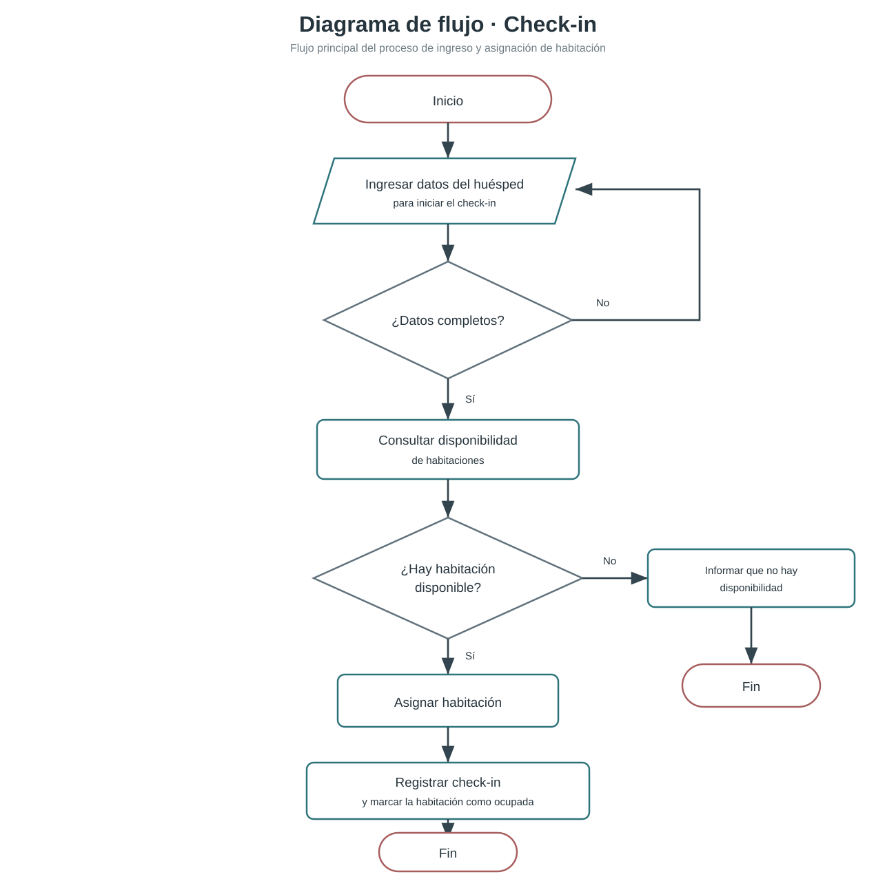

# Sistema de Pasajeros — Hotel Duerme Bien

**Caso 6 · Entrega de modelado y prototipo**

Este repositorio presenta **todos los entregables directamente en esta página**, con las versiones actualizadas de los diagramas. Cada imagen se puede abrir en tamaño completo; los archivos fuente siguen disponibles para editarlos.

**[Abrir prototipo funcional](https://yutre3.github.io/diego/prototipo-web/prototipo-funcional.html)** · **[Ver fuentes PlantUML](diagramas-plantuml/)** · **[Ver informe de requerimientos](entrega-final/01-requerimientos.md)**

## 1. Informe de requerimientos

[Leer el informe completo](entrega-final/01-requerimientos.md)

El sistema abarca habitaciones, huéspedes, reservas, disponibilidad, check-in, check-out, costos por pasajero, perfiles e informes. Los permisos detallados y la fórmula de cobro exacta continúan pendientes de validación.

## 2. Diagrama de casos de uso

### 2.1 Vista general — Encargado y administrador

[Ver imagen completa](entrega-final/02-casos-de-uso.svg) · [Fuente PlantUML](diagramas-plantuml/casos-de-uso.puml) · [Editar en diagrams.net](https://app.diagrams.net/?mode=github#HYutre3%2Fdiego%2Fmain%2Fdiagramas-editables%2F01-casos-de-uso.drawio)

### 2.2 Vista detallada — Relaciones include y extend

[Ver imagen completa](entrega-final/02-casos-de-uso-detalle.svg) · [Fuente PlantUML](diagramas-plantuml/casos-de-uso-detalle.puml)

## 3. Diagramas de flujo

### 3.1 Flujo general — Reservas, entrada, salida y administración

[Ver imagen completa](entrega-final/03-flujo-general.svg) · [Fuente PlantUML](diagramas-plantuml/flujo-general.puml)

### 3.2 Flujo detallado — Check-in

[Ver imagen completa](entrega-final/03-diagrama-flujo.svg) · [Editar en diagrams.net](https://app.diagrams.net/?mode=github#HYutre3%2Fdiego%2Fmain%2Fdiagramas-editables%2F02-diagrama-flujo.drawio)

## 4. Modelo de base de datos

[Ver imagen completa](entrega-final/04-modelo-base-datos.svg) · [Fuente PlantUML](diagramas-plantuml/modelo-base-datos.puml) · [Editar en diagrams.net](https://app.diagrams.net/?mode=github#HYutre3%2Fdiego%2Fmain%2Fdiagramas-editables%2F03-modelo-base-datos.drawio)

El modelo contiene tablas para usuarios, habitaciones, huéspedes, reservas y estadías, más las relaciones para asociar varios huéspedes. Los elementos propuestos están señalados y requieren validación.

## 5. Sketch — Boceto inicial de las pantallas

[Ver imagen completa](entrega-final/05-sketch.svg) · [Editar interfaz](https://app.diagrams.net/?mode=github#HYutre3%2Fdiego%2Fmain%2Fdiagramas-editables%2F04-interfaz.drawio)

## 6. Wireframe — Estructura de la interfaz

[Ver imagen completa](entrega-final/06-wireframe.svg)

## 7. Mockup — Diseño visual

[Ver imagen completa](entrega-final/07-mockup.svg)

## 8. Prototipo funcional

**[Abrir y probar el prototipo en el navegador](https://yutre3.github.io/diego/prototipo-web/prototipo-funcional.html)**

La imagen es una vista de referencia; el enlace permite acceder al prototipo navegable.

## 9. Kanban — Planificación del trabajo

El tablero conserva las tareas terminadas, en revisión y pendientes de confirmación.

Este tablero contiene solamente tareas relacionadas con los entregables solicitados para el Caso 6.

| Por hacer / pendiente de validación | En revisión | Terminado |
| --- | --- | --- |
| Incorporar retroalimentación real de Evaluación 1 cuando sea entregada | Revisar coherencia final entre requerimientos, diagramas y prototipo | Informe IEEE 830 adaptado |
| Validar fórmula exacta del costo por pasajero |  | Diagrama de casos de uso |
| Validar datos obligatorios del huésped |  | Diagrama de flujo de check-in |
| Validar permisos detallados por perfil |  | Diagrama de base de datos |
| Confirmar reglas exactas para modificar/cancelar reservas |  | Sketch |
|  |  | Wireframe |
|  |  | Mockup |
|  |  | Prototipo funcional navegable |
|  |  | Funciones de habitaciones, huéspedes y reservas |
|  |  | Funciones de check-in y check-out |
|  |  | Gestión de usuarios en el prototipo |
|  |  | Informes de ocupación y reservas |

[Ver el archivo Kanban completo](entrega-final/09-kanban.md)

---

**Archivos editables:** [PlantUML](diagramas-plantuml/) · [diagrams.net](diagramas-editables/) · [Guía de diagramas](docs/diagramas-plantuml.md)

*El material gráfico presenta el diseño y modelado académico. No debe interpretarse como garantía de implementación completa de todas las funciones del sistema.*
